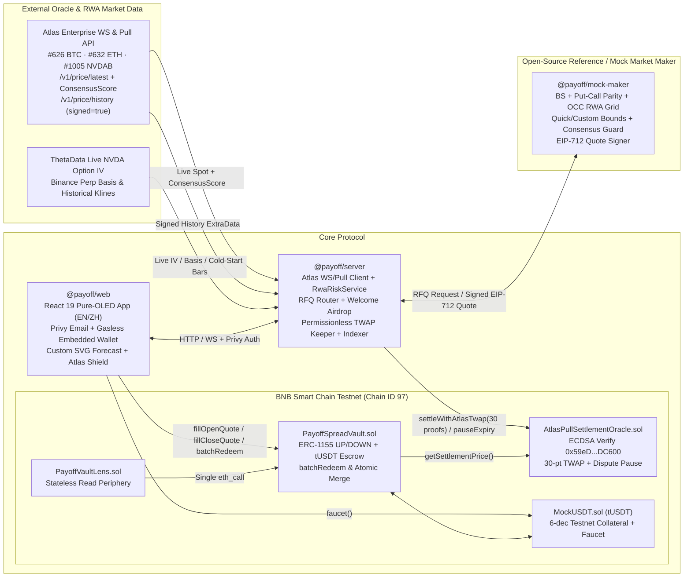

# Payoff — Continuous-Payout Crypto & RWA Prediction Markets on BNB Chain

**Be Right on Direction and Actually Get Paid.**  
*Continuous-payout crypto & 24/7 tokenized equity (RWA) prediction markets on BNB Chain—turning 60 fragmented all-or-nothing lottery rows into one smooth, zero-liquidation ticket, backed by competitive EIP-712 RFQ liquidity, Privy email gasless onboarding, and trustless 30-Minute Atlas Pull Oracle TWAP settlement.*

Built for the **HackQuest BNB Bangkok Hackathon** — targeting the **Developer Track** and the **CoinMarketCap × Atlas Challenge**.

> **Live App (BNB Smart Chain Testnet — Gasless Email Sign-In + Free 1,000 `tUSDT` Welcome Airdrop):** [https://bnb.payoff.finance/](https://bnb.payoff.finance/)  
> **Read the 1-page hackathon submission brief:** [`docs/HACKATHON_ONE_PAGER.md`](./docs/HACKATHON_ONE_PAGER.md)  
> **Inspect the transparent odds & market-making engine:** [`packages/mock-maker/README.md`](./packages/mock-maker/README.md)

---

## Why Continuous-Payout Prediction Markets? (Real Product Comparison vs. Polymarket)

Prediction markets like Polymarket and Kalshi have proven massive consumer demand—and **short-term price markets** are one of their highest-frequency daily categories.  
Yet when you open a real daily BTC prediction page on Polymarket today (`BTC spot ≈ $60,276`), **forcing continuous asset prices into `0-or-1` binary contracts creates four concrete, unsolved problems**:

1. **You Can Nail a `+$1,200` Rally and Still Lose `100%` (`$0`)**:
   - On Polymarket's daily BTC market (`spot = $60,276`), buying a **`5.0x`** bullish ticket means picking **`$61,750 or above`** (~20% implied win rate).
   - If BTC surges **`+$1,224` (`+2.0%`)** to **`$61,500`** at expiry, your directional call was completely right—yet a binary market pays you **`$0` (`-100%` wipeout)**.
   - To avoid being wiped out by missing a single threshold, a trader would have to manually split funds across **8–10 separate rows** (`$60,000`, `$60,250`, `$60,500`…), paying spread and fees every time.
2. **60 Fragmented Rows—Over Half Dead (`—`) With Zero Liquidity**:
   - To offer multipliers from `1.01x` to `20x`, binary platforms split a single expiry into **60+ narrow orderbooks**. More than half sit completely empty (`—`) because quoting dozens of razor-thin `0-or-1` thresholds exposes market makers to extreme **expiry pin-risk**.
   - Every row is phrased as `$XX,XXX or above`, forcing bearish traders to mentally invert rows and hunt for `No` liquidity instead of simply clicking **Down**.
3. **High-Churn "Lottery Economics" vs. Sustainable Trading Retention**:
   - All-or-nothing tickets wipe retail bankrolls to `$0` ~80% of the time on high-multiplier tiers—users bust twice and churn permanently, forcing platforms to burn acquisition spend.
   - *(Meanwhile, switching to **Perpetual Futures** exposes retail traders to sudden overnight wick liquidations even when their next-day view is right.)*
4. **The Expiry Manipulation Cliff**:
   - In a `0-or-1` price market, moving spot by a few dollars at the exact settlement second flips `100%` of the pot from `YES` to `NO`, creating massive incentives for last-second manipulation.

---

## Side-by-Side Reality Check: The Same `$100` `~5x` BTC Bet (`Spot = $60,276`)

Instead of forcing traders to gamble on one razor-thin price cliff, **Payoff** collapses an entire price ladder into **one continuous-payout ticket**: pick **`NVDA` (24/7 RWA default)**, **`BTC`**, or **`ETH`**, choose **`Up`** or **`Down`**, and dial in your **Target Cap** via a **Quick** fine-step slider or **Custom** dual-range slider.

Compare what happens tomorrow at settlement with the **exact same `$100` stake** and **comparable `~5x` max upside**:

| Tomorrow's BTC Settlement Price | Move vs. `$60,276` | Traditional Binary Market<br/>(`$61,750 or above`, `5.0x`) | **Payoff Continuous-Payout**<br/>(`$60,000 → $64,000`, `~4.8x`) | Real Trader Takeaway |
|---|---|---|---|---|
| **`$60,276`** (Flat) | `0.0%` | **`$0`** (`-100%` wipeout) | **`~$33`** (recovers ~1/3 stake) | Sideways doesn't wipe you out |
| **`$60,900`** (Small rally) | `+1.0%` | **`$0`** (`-100%` wipeout) | **`~$108`** (**`+8%` profit**) | Already in profit on a `+1%` move |
| **`$61,500`** (Strong rally) | `+2.0%` | **`$0`** (`-100%` wipeout) | **`~$180`** (**`+80%` profit**) | **Nailed a `+$1,224` rally: `+80%` instead of `-100%`** |
| **`$61,800`** (Breakout) | `+2.5%` | **`$500`** (`+400%` cliff pop) | **`~$216`** (`+116%` profit) | Binary's lottery pop zone vs. smooth scaling |
| **`$64,000`** (Full target) | `+6.2%` | **`$500`** (`+400%`) | **`~$480`** (`+380%` full cap) | Both hit full `~5x` ceiling |

> **Honest Trade-Off**: Binary `0-or-1` markets still win for pure lottery buyers chasing an instant cliff pop right past a single threshold (`$61,800`). **Payoff** is built for **directional traders who want prediction-market simplicity without getting wiped out to `$0` when their thesis is right**—roughly doubling directional win rate on the same `~5x` cap while keeping residual value on sideways days.

---

## Live Markets — 24/7 Tokenized Equity RWA + Crypto

Payoff runs **three live continuous-payout markets** on BNB Smart Chain Testnet, landing by default on **NVIDIA (`NVDA`) RWA** to showcase 24/7 tokenized equity prediction markets alongside BTC and ETH:

| Market | Asset Class | Atlas Pull Feed ID | Settlement Schedule (30m TWAP) | Pricing & Risk Engine |
|---|---|---|---|---|
| **`NVDA` (`NVDAB`, Default)** | Tokenized US Equity RWA (`bStock`) | **`#1005`** (`0x000003ed`, `NVDAB/USD`) | **US Equity Close `21:00 UTC`** (`20:31–21:00 UTC`, Mon/Wed/Fri & NYSE holiday calendar) | Real OCC strike ladder (`$1` / `$2.50` / `$5`), ThetaData live NVDA option IV surface, 24/7 session regimes (`RTH` / `EXTENDED` / `WEEKEND`), Binance Perp spot-perp basis buffer, automatic **>1% `shareMultiplier` split & corporate-action circuit breaker** |
| **`BTC`** | Crypto | **`#626`** (`0x00000272`, `BTC/USD`) | **Daily & Weekly `08:00 UTC`** (`07:31–08:00 UTC`) | Fine `$500` strike grid + Black-Scholes & strict Put-Call Parity + Atlas `ConsensusScore` spread/IV guard |
| **`ETH`** | Crypto | **`#632`** (`0x00000278`, `ETH/USD`) | **Daily & Weekly `08:00 UTC`** (`07:31–08:00 UTC`) | Fine `$25` / `$50` strike grid + Black-Scholes & strict Put-Call Parity + Atlas `ConsensusScore` spread/IV guard |

---

## Consumer Experience & Pure-Black OLED Interface (`@payoff/web`)

Designed with a borderless pure-OLED black (`#000000`) editorial fintech aesthetic in **English & Chinese (`EN / 中文`)**:

1. **Web2-Grade Zero-Friction Onboarding (Privy Email + Gasless + Instant `1,000 tUSDT`)**:
   - **1-Click Email Sign-In**: Powered by **Privy Embedded Wallets** (`createOnLogin`), silently aligned to BNB Smart Chain Testnet (`Chain ID 97`) with **gas sponsorship** so users trade with **zero `tBNB` required**.
   - **Automatic Welcome Airdrop & Testnet Faucet**: First-time sign-in automatically mints **`1,000 tUSDT`** on-chain to the user's embedded wallet, supplemented anytime by a monochrome top-bar **`Mint`** faucet modal, plus full **Deposit (BEP-20 QR)**, **Withdraw**, and **Export Wallet Key** controls.
   - **Interactive 3-Step Spotlight Onboarding Tour**: Automatically highlights live controls (`Up/Down & target slider` → `continuous payoff curve` → `capped-loss CTA`) on first visit and is replayable anytime from the rules drawer.
2. **Quick Fine-Step Slider + Custom Dual-Range Mode**:
   - **Quick Mode**: Smooth single slider anchored on the hysteresis strike grid across fine native steps (`NVDA` OCC strikes, `BTC $500`, `ETH $25`), showing live `Full win at`, multiplier, and an interactive **Mini PnL Curve** right inside the order card.
   - **Custom Mode**: Dual **Start / Target Cap** range sliders with zero-latency client preview and server-authoritative guardrail clamping (`~1.15x–20x` fair bounds).
   - **Unified Buy / Sell Amount Box**: Clean `$` input with clickable `Available` max-fill and `25% / 50% / 75% / Max` presets (or `$20 / $50 / $100 / $500` before sign-in).
3. **Full-Bleed Custom SVG Forecast Chart + Official `Powered by Atlas` Inspector**:
   - Custom pure-black SVG forecast chart (replacing TradingView) automatically matches the `24H` (Daily) or `7D` (Weekly) history window to the selected expiry tab, seamlessly flowing from live spot into the future linear payoff ramp with an interactive **track-side price scrubber** for instant what-if payout simulation.
   - Next to the live `36px` spot price sits an official dark-mode **`Powered by Atlas`** pill; clicking it opens the live **Rules & Atlas Oracle Shield** drawer showing real-time Feed ID, `ConsensusScore`, `TWAP / Median`, on-chain Oracle & ECDSA Signer BscScan links, recent official Atlas settlements, and a direct link to [`atlasoracle.io`](https://atlasoracle.io/).
4. **Arbitrary-Amount Early Cashout & Single-Column `Portfolio`**:
   - **Custom USD Partial or Full Early Exit**: Click **`Sell`** directly on any active position row (on either `Trade` or `Portfolio`) to cash out any custom USD amount (`25% / 50% / 75% / Max`, dust-safe full close when `>= 99.5%`, clean 3-row receipt `You receive / Realized PnL / Remaining`, and `1.5%` adverse-slippage circuit breaker).
   - **Centered `Trade | Portfolio` Header & Editorial Single-Column Portfolio**: Merged right-side `[Avatar $Balance ▾]` account pill, live position count badge on `Portfolio`, proportional balance allocation bar (`Available / In Positions / Ready to Claim`), icon-only BscScan links, permissionless **Settle with Atlas 30m TWAP**, aggregated **`batchRedeem`** claiming, and `History & Stats`.

---

## How Payoff Solves Every Layer of the Stack

1. **Market Maker Economics & Real Protocol Revenue**:
   - **Fixes the "Dead Rows" Liquidity Problem**: Wide continuous-payout ranges strictly bound market-maker exposure near expiry (eliminating the extreme pin-risk that causes binary orderbooks to go empty). Liquidity concentrates on anchored strike pools backed `1:1` (`1 UP + 1 DOWN = 1 tUSDT`) inside `PayoffSpreadVault.sol`, with **atomic `UP + DOWN` merge unlocks** immediately freeing maker collateral on early exits (`+25 bps` price improvement passed back to users).
   - **Built for Sustainable Retention & Day-1 Cashflow**: Because traders aren't constantly wiped to `$0` on near-misses or flat days, retail bankrolls last multiple rounds longer—driving higher repeat volume and organic on-chain USDT protocol fees without relying on token subsidies.
2. **Double-Layer Manipulation Resistance — Continuous Slope + Atlas 30-Minute TWAP & `ConsensusScore`**:
   - **No `$1` Settlement Cliff**: Moving spot by a small amount at expiry barely shifts a continuous payout, removing the economic incentive for last-second settlement manipulation.
   - **Trustless 30-Minute TWAP Expiry Settlement via Atlas Pull Oracle**: Aligned with institutional settlement standards, anyone can settle expired markets permissionlessly on BSC Testnet by submitting **30 deterministic 1-minute Atlas Enterprise signed historical proofs** (`07:31–08:00 UTC` for BTC/ETH; `20:31–21:00 UTC` for NVDAB via `/v1/price/history`, `signed: true`). `AtlasPullSettlementOracle` verifies all 30 ECDSA signatures against Atlas's official signer (`0x59eD4701224fD9e2a85Ef2946c2ab828C1dDC600`) in one atomic transaction (`0s` exact-second match within 15m after expiry, `±10s` liveness fallback thereafter), computes the equal-weighted mean once for all redemptions, and locks early closes 30 minutes before expiry.
   - **Deep Atlas Enterprise `ConsensusScore` Protection & Dispute Guard**: Live multi-venue consensus health (`HEALTHY` / `DEGRADED` / `WARNING` / `CRITICAL` / `SPLIT_MARKET`) and `priceVolatility` drive real-time UI shields, dynamic odds-maker risk spreads (fail-closed if Atlas goes offline/stale `>60s`), and a 30-minute aggregate health check (`avgConsensusScore < 0.40` automatically freezes the disputed expiry on-chain via a pause-only `pauser` sentinel for transparent admin `emergencyManualSettle` with a public audit reason).

---

## Architecture Overview

Payoff enforces a clean architectural boundary between the **Core Continuous-Payout Protocol** (permissionless 30m TWAP settlement & 100%-collateralized escrow vault) and the **Open-Source Reference Odds / Market Maker** (`packages/mock-maker`), which prices continuous `[Start Line, Target Cap]` payoff ranges openly in this repository so judges can audit the exact financial math driving every live quote.



### Monorepo Packages

| Package | Role | Key Highlights |
|---|---|---|
| [`packages/shared`](./packages/shared) | `@payoff/shared` | BSC Testnet chain config (`97`), Atlas feed IDs (`#626` BTC, `#632` ETH, `#1005` NVDAB), US equity holiday/MWF expiry calendar, contract ABIs, EIP-712 types, Black-Scholes, Quick/Custom client preview & guardrails |
| [`packages/contracts`](./packages/contracts) | `@payoff/contracts` | `AtlasPullSettlementOracle.sol` (built on `oracle-atlas/pull-oracle-consumer`), `PayoffSpreadVault.sol` (incl. `batchRedeem` & atomic merge), `PayoffVaultLens.sol`, `MockUSDT.sol`, Hardhat tests, deploy/verify & RWA registration scripts |
| [`packages/mock-maker`](./packages/mock-maker) | `@payoff/mock-maker` | Publicly auditable Reference Market Maker: Black-Scholes + strict Put-Call Parity no-arbitrage, dense Quick & Custom dual-range shelf, NVDAB OCC strikes & 24/7 RWA session/basis/split guards, Atlas `ConsensusScore` risk engine, EIP-712 signer |
| [`packages/server`](./packages/server) | `@payoff/server` | Atlas Enterprise WS + HTTP Pull client, `RwaRiskService` (ThetaData IV, Binance Perp basis, >1% split guard), Privy token verification & `1,000 tUSDT` welcome airdrop, permissionless TWAP keeper, thin RFQ router, Postgres/SQLite indexer & WebSocket stream |
| [`packages/web`](./packages/web) | `@payoff/web` | React 19 + Vite pure-black OLED consumer app (defaulting to **NVDA RWA**), Privy email gasless login, custom SVG forecast & mini PnL charts, Quick/Custom sliders, unified Buy & arbitrary-amount Sell modal, Spotlight tour, `Powered by Atlas` live inspector, single-column `Portfolio`, EN/ZH i18n, `/ops` solvency dashboard |

---

## Deployed Contracts — BNB Smart Chain Testnet (Chain ID `97`)

Deployment manifest: [`packages/contracts/deployments/bscTestnet.json`](./packages/contracts/deployments/bscTestnet.json) (Deployment Block: **`144840259`**)

| Contract | Address (BscScan Testnet) | Decentralized Verification (Sourcify v2) | Role |
|---|---|---|---|
| **`MockUSDT` (`tUSDT`)** | [`0x20845985df410F84c2e30Ba44A19dD564baE9bED`](https://testnet.bscscan.com/address/0x20845985df410F84c2e30Ba44A19dD564baE9bED) | [`exact_match`](https://repo.sourcify.dev/97/0x20845985df410F84c2e30Ba44A19dD564baE9bED) | 6-decimal testnet USDT collateral with public `faucet()` & welcome airdrop mint |
| **`AtlasPullSettlementOracle`** | [`0x00ea779192dAd354D25016841e3Ff2Bc8f545114`](https://testnet.bscscan.com/address/0x00ea779192dAd354D25016841e3Ff2Bc8f545114) | [`exact_match`](https://repo.sourcify.dev/97/0x00ea779192dAd354D25016841e3Ff2Bc8f545114) | Permissionless 30m (30×1m) Atlas TWAP ECDSA oracle (`BTC`, `ETH`, `NVDAB`) + dispute pause |
| **`PayoffSpreadVault`** | [`0x5a6AaD747cd5313E31fa663fF719b2a18fF00174`](https://testnet.bscscan.com/address/0x5a6AaD747cd5313E31fa663fF719b2a18fF00174) | [`exact_match`](https://repo.sourcify.dev/97/0x5a6AaD747cd5313E31fa663fF719b2a18fF00174) | Core 100%-collateralized ERC-1155 `UP`/`DOWN` escrow vault (30m close lock + `batchRedeem`) |
| **`PayoffVaultLens`** | [`0x831532F56ac6aB2B628a7b6cEAb1Eef3a828d60E`](https://testnet.bscscan.com/address/0x831532F56ac6aB2B628a7b6cEAb1Eef3a828d60E) | [`exact_match`](https://repo.sourcify.dev/97/0x831532F56ac6aB2B628a7b6cEAb1Eef3a828d60E) | Stateless read-only periphery for single-call UI/indexer queries |

> **On-chain protocol parameters**: `protocolOpenFeeBps = 400` (4%, hard-capped ≤ 500 bps), `protocolCloseFeeBps = 0` (hard-capped ≤ 100 bps), `MIN_OPEN_LEAD_TIME = 1h`, `MIN_CLOSE_LEAD_TIME = 30m`, TWAP `30 samples × 60s` (`settlementDelay = 60s`, `exactMatchGracePeriod = 15m`, `fallbackTimestampTolerance = ±10s`), reference market maker pre-funded with `1,000,000 tUSDT` in `makerMargin` using exact finite approval.

---

## Live Verified On-Chain Atlas Pull Oracle Proof

`AtlasPullSettlementOracle` inherits unmodified `PullOracleConsumerBase` (`oracle-atlas/pull-oracle-consumer`), verifies ECDSA signatures from **Atlas Oracle's official production signer** (`0x59eD4701224fD9e2a85Ef2946c2ab828C1dDC600`, trailing calldata marker `0x7096`), and supports:
- **`NVDAB/USD` (Default RWA)**: Feed ID **`#1005`** (`bytes4(0x000003ed)`), `21:00 UTC` US Close TWAP
- **`BTC/USD`**: Feed ID **`#626`** (`bytes4(0x00000272)`), `08:00 UTC` TWAP
- **`ETH/USD`**: Feed ID **`#632`** (`bytes4(0x00000278)`), `08:00 UTC` TWAP

### Live BSC Testnet Verification Results (`pnpm verify:atlas:bsc`)

1. **Live `eth_call` `verifyLatestAtlasPrice` (Freshness-checked on BSC Testnet)**:
   - `BTC/USD` (`0x00000272`): **`$59,653.75598044`** @ `ts=1795633291` · `ConsensusScore = 93.27% (HEALTHY)`
   - `ETH/USD` (`0x00000278`): **`$1,679.40804865`** @ `ts=1795633291` · `ConsensusScore = 93.49% (HEALTHY)`

2. **Live Permissionless 30-Point 1-Minute TWAP Settlement Transaction (`settleWithAtlasTwap`)**:
   - **Transaction Hash**: [`0xe4b6067ea5ba92d688746adf0ac547406fada9f28a81e0250137b5265de2dc90`](https://testnet.bscscan.com/tx/0xe4b6067ea5ba92d688746adf0ac547406fada9f28a81e0250137b5265de2dc90) (Block **`144840391`**, **`344,021` gas**)
   - **Call**: `settleWithAtlasTwap(keccak256("BTC"), 1795593600, proofs[30])` with 30 signed Atlas Enterprise `/v1/price/history` (`signed: true`) proofs spanning `2026-11-25T07:31:00Z` to `2026-11-25T08:00:00Z` (`maxTimestampDiff = 0s`)
   - **Verified On-Chain State (`getSettlement` & `getSettlementMeta`)**:
     - `settled`: `true`, `isManualOverride`: `false`, `sampleCount`: `30`
     - `price`: **`$58,750.15513875`** (`5875015513875`, exact 30-point equal-weight arithmetic mean scaled safely from 18-dec Atlas prices)
     - `feedId`: `0x00000272` (`#626`), `window`: `[1795591860 .. 1795593600]`

---

## Deep Atlas Enterprise `ConsensusScore` & RWA Guard Integration

Rather than treating an oracle as a passive price number, Payoff wires Atlas Enterprise **`consensusScores`** (`consensusScore`, `consensusStatus`, `twapPrice`, `medianPrice`, `priceVolatility`) and RWA feed metadata (`shareMultiplier`) across all three layers of the stack:

1. **Consumer UI — `Powered by Atlas` Pill & Real-Time Oracle Shield (`AtlasBrand.tsx` + `AtlasOracleBadge.tsx`)**:
   - Surfaces the official Atlas brand mark directly beside the live spot price on the `Trade` screen; clicking opens the native `<dialog>` **Rules & Oracle** drawer displaying live `HEALTHY` status & `ConsensusScore`, Feed ID (`#1005 NVDAB/USD` / `#626 BTC/USD` / `#632 ETH/USD`), TWAP vs. Median, `priceVolatility`, separated clickable BscScan links for the **Oracle Contract** and **Authorized ECDSA Signer**, recent official TWAP settlements, and a direct link to `atlasoracle.io`.
   - On both `Trade` and `Portfolio`, locks Early Close during the final 30m TWAP window and provides a permissionless **"Settle with Atlas 30m TWAP"** action after expiry (or a clear disputed-pause notice if frozen).
2. **Backend — 30m TWAP Health Sentinel, `RwaRiskService` & Permissionless Keeper (`atlasOracle.ts` + `rwaRiskService.ts` + `chainService.ts`)**:
   - Streams live updates over `wss://push.atlasoracle.io/ws` (with zombie-socket ping/reconnect watchdog and automatic HTTP fallback to `POST /v1/price/latest`, strict server-side `X-API-KEY` isolation).
   - Aggregates 1-minute bucketed `consensusScore` observations across each asset's final 30-minute window (`07:31–08:00 UTC` for crypto; `20:31–21:00 UTC` for NVDAB). In a two-pass keeper cycle, if coverage reaches `>= 20/30` minutes and the average drops below **`40%` (`0.40`)**—or becomes mathematically irrecoverable—the `pauser` sentinel immediately calls `pauseExpiry()` on-chain during the 60s pre-permissionless buffer for transparent admin `emergencyManualSettle(assetId, expiry, price, reason)`.
   - For **`NVDAB` RWA**, monitors Atlas `feed-detail` `shareMultiplier` drift (`> 1.0%` triggers an automatic split circuit breaker that blocks opens and pauses the expiry), enforces corporate-action blackouts, classifies DST-aware US equity sessions (`RTH` / `EXTENDED` / `WEEKEND`), and ingests live NVDA option IV via ThetaData + spot-perp basis via Binance Futures.
3. **Reference Market Maker — Dynamic Spread & Fail-Closed Quoting Guard (`packages/mock-maker` + `rfqGateway.ts`)**:
   - `computeConsensusRiskAdjustments(atlasTelemetry)` widens ask/bid spreads (`1.35x` on `DEGRADED`, `1.85x–2.0x` on `WARNING`) and boosts the Black-Scholes IV floor automatically when `priceVolatility > 0.5%` (single-source in `ShelfEngine`, zero double-counting).
   - Halts new `OpenQuote` signing on `CRITICAL` / `SPLIT_MARKET` or active RWA split/blackout guards while keeping `CloseQuote` exits live, and fails closed (HTTP 503) if the live Atlas feed goes offline or stale (`>60s` local / `>90s` oracle timestamp).
   - Full mathematical specification and Put-Call Parity proof in [`packages/mock-maker/README.md`](./packages/mock-maker/README.md).

---

## Local Setup, Testing & Deployment

### Prerequisites
- Node.js `>= 20` and `pnpm@10.32.0`
- An Atlas Enterprise API key (`ATLAS_API_KEY`) for live Atlas WS/Pull data (automated tests run 100% offline with embedded production Atlas signature fixtures)
- A Privy app (`PRIVY_APP_ID` and server-side `PRIVY_APP_SECRET`) for email login, embedded wallet creation, and gasless BSC Testnet execution

### 1. Install & Configure Environment
```bash
pnpm install
cp .env.example .env
# Edit .env to supply server-side ATLAS_API_KEY, PRIVY_APP_ID, PRIVY_APP_SECRET
# (and TESTNET_WALLET_PK / MM1_PRIVATE_KEY if deploying contracts or funding welcome airdrops)
# Never expose ATLAS_API_KEY, PRIVY_APP_SECRET, or private keys to packages/web or commit .env
```

### 2. Build & Run Full Automated Test Suite (`66/66` Passing)
```bash
pnpm build:shared && pnpm test:shared          # 19/19 passing
pnpm build:mock-maker && pnpm test:mock-maker  # 10/10 passing (incl. NVDAB OCC, Quick/Custom & RWA guards)
CI=true pnpm compile:contracts && CI=true pnpm test:contracts  # 17/17 passing (incl. 30-pt TWAP, NVDAB 21:00 UTC, & real Atlas 0x59eD...DC600 tests)
pnpm test:server && pnpm build:server          # 20/20 passing (incl. RwaRiskService, Privy airdrop & Quick/Custom shelf)
pnpm build:web                                 # React 19 + Vite production bundle
pnpm typecheck                                 # Full workspace strict TypeScript check
```

### 3. Run Locally Against Deployed BSC Testnet Contracts
```bash
# Terminal 1: Start API + WebSocket server (reads packages/contracts/deployments/bscTestnet.json)
pnpm dev:server

# Terminal 2: Start React 19 frontend (http://localhost:5173)
pnpm dev:web
```
Optional Docker setup (PostgreSQL 16 + Server with bundled ThetaData Python venv):
```bash
docker compose up --build
```

### 4. Deploy, Register RWA Assets & Verify Contracts on BNB Smart Chain Testnet
```bash
# Deploy MockUSDT, AtlasPullSettlementOracle, PayoffSpreadVault, PayoffVaultLens + fund MM margin
pnpm deploy:bsc

# Register NVDAB tokenized equity RWA (Atlas #1005 / 0x000003ed, 21:00 UTC US Close)
pnpm register:rwa:bsc

# Verify live Atlas Pull eth_call + execute real on-chain 30-point settleWithAtlasTwap tx on BSC Testnet
pnpm verify:atlas:bsc

# Verify all 4 contracts on Sourcify v2 (and BscScan when BSCSCAN_API_KEY is set)
pnpm --filter @payoff/contracts verify:bsc
```

### 5. Emergency Admin Settlement CLI (Disputed Expiries)
When an expiry is frozen on-chain (either automatically by the `pauser` sentinel on `avgConsensusScore < 0.40` or RWA split guard, or manually by the admin), automated TWAP settlement is locked and must be resolved via [`packages/contracts/scripts/emergency-settle.ts`](./packages/contracts/scripts/emergency-settle.ts) (owner/pauser private key only, never exposed via HTTP API):

```bash
cd packages/contracts

# 1. Optional: manually freeze a disputed expiry (verifies on-chain configured asset, settlement UTC hour, and post-tx paused state)
ACTION=pause ASSET=BTC EXPIRY=1795593600 npx hardhat run scripts/emergency-settle.ts --network bscTestnet

# 2. Dry-run irreversible manual settlement (prints live on-chain state & runs staticcall without broadcasting)
ACTION=settle ASSET=BTC EXPIRY=1795593600 PRICE_USD=64250.50 REASON="Atlas 30m avg score < 0.40" npx hardhat run scripts/emergency-settle.ts --network bscTestnet

# 3. Broadcast confirmed manual settlement on BSC Testnet (requires explicit CONFIRM=yes on non-local chains)
ACTION=settle ASSET=BTC EXPIRY=1795593600 PRICE_USD=64250.50 REASON="Atlas 30m avg score < 0.40" CONFIRM=yes npx hardhat run scripts/emergency-settle.ts --network bscTestnet
```
> Built-in safety rails: refuses ephemeral `--network hardhat`, rejects unconfigured asset names or millisecond timestamps (use `FORCE=1` only for non-standard test expiries), parses `PRICE_USD` strictly with `ethers.parseUnits(raw, 8)` (no float rounding), and requires `CONFIRM=yes` before broadcasting `emergencyManualSettle`.

---

## Security & Privacy Highlights

- **100% Collateralized Vault Invariant**: `usdt.balanceOf(vault) >= totalLockedUsdt + totalMakerMargin + accruedProtocolFees` enforced across every open, early close, atomic merge, `redeem` / `batchRedeem`, fee pull, and rescue path.
- **Role-Separated Governance & Pause-Exempt Exits**: `Ownable2Step`, `ReentrancyGuard`, `Pausable`, dedicated `pauser` & `feeCollector`; `merge()`, `redeem()`, `batchRedeem()`, and `withdrawMakerMargin()` remain intentionally unpaused so users and makers can always recover funds.
- **Server-Side Secret Isolation**: `ATLAS_API_KEY`, `PRIVY_APP_SECRET`, and maker private keys live exclusively in gitignored `.env` on the backend—never bundled into `packages/web`, never returned by `/api/health` or `/api/oracle/consensus`, and never committed to Git.

## License

- Core protocol (`packages/shared`, `packages/contracts`, `packages/mock-maker`, `packages/server`, `packages/web`): MIT License.
- Vendored Atlas Pull Oracle consumer libraries (`packages/contracts/contracts/atlas/*`): `BUSL-1.1` (original headers preserved from [`oracle-atlas/pull-oracle-consumer`](https://github.com/oracle-atlas/pull-oracle-consumer)).
