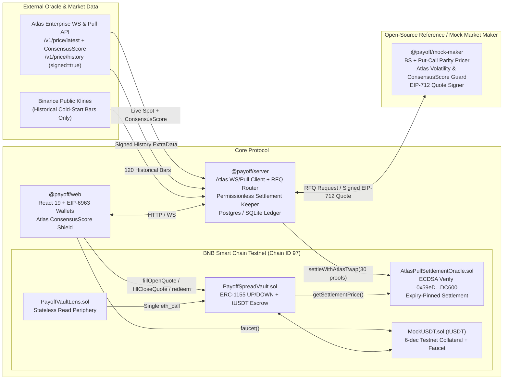

# Payoff — The First Structured Prediction Market on BNB Chain

**Events Are Binary. Asset Prices Are Continuous.**  
*Trade crypto direction with an anchored Start Line, customizable Target Multipliers (`1.5x`–`5x+`), continuous payouts, zero intraday liquidations, and trustless 30-Minute TWAP Atlas Pull Oracle settlement.*

Built for the **HackQuest BNB Bangkok Hackathon** — targeting the **Developer Track** and the **CoinMarketCap × Atlas Challenge**.

> **Read the 1-page hackathon submission brief:** [`docs/HACKATHON_ONE_PAGER.md`](./docs/HACKATHON_ONE_PAGER.md)  
> **Inspect the transparent odds & market-making engine:** [`packages/mock-maker/README.md`](./packages/mock-maker/README.md)

---

## Why a Structured Prediction Market?

First-generation prediction markets (like Polymarket) are **Binary (`Yes / No`)**.  
Binary markets are natural for discrete events like elections or sports—where the real-world outcome is strictly `Yes` or `No`.

When applied to **continuous financial asset prices (`BTC`, `ETH`)**, however, binary prediction markets break down:
1. **The All-or-Nothing Cliff (`$1` Short = `100%` Wipeout)**: If you predict BTC will reach `$62,000` and it rallies from `$60,000` to `$61,990`, your directional call was completely right—yet a binary market pays you **`$0`**.
2. **No Freedom to Express Magnitude**: Whether you expect a modest `+1.5%` move or a `+6%` breakout, a single `Yes/No` market forces everyone into one rigid line and one fixed odds profile (or fragments liquidity across 10 separate price-bracket pools).
3. **Expiry Cliff Manipulation**: In a `0-or-1` price market, pushing spot by a few dollars at expiry flips `100%` of the pool from `YES` to `NO`, creating huge incentives for last-second price manipulation.
4. **And Perpetual Futures Aren't the Answer for Casual Directional Bets**: High-leverage perps liquidate traders on temporary intraday wicks and bleed funding even when their end-of-day thesis is right.

---

## What Makes Payoff a *Structured* Prediction Market?

Instead of forcing continuous prices into a `0` or `1` binary box, **Payoff** introduces **Structured Prediction Markets** on **BNB Smart Chain**.

| Dimension | Traditional Binary Prediction Market (`0` or `1`) | **Payoff — Structured Prediction Market** |
|---|---|---|
| **Built For** | Discrete events (elections, sports, yes/no rulings) | **Continuous asset prices (`BTC`, `ETH`, crypto & macro metrics)** |
| **User Choice** | Pick `Yes` or `No` on a single fixed threshold | Pick **`UP` / `DOWN`** + **how far price will reach (Target Cap & Multiplier Tier)** |
| **Payout Curve** | All-or-nothing cliff (`$1` miss = `0` payout) | **Continuous payout** from the anchored **Start Line** up to your **Target Cap** |
| **If Price Stays Flat** | Frequently `100%` loss if below the threshold | **Built-in Start Line cushion** recovers a portion of stake on conservative/standard tiers |
| **Intraday Wick Risk** | High pin-risk spread spikes near expiry | **Zero liquidations** (100% collateralized in `tUSDT`) + **1-click early cashout anytime** |
| **Expiry Fairness** | `$1` move at expiry flips `100%` of the pot | **Continuous payout slope + 30-Minute Atlas TWAP (`30 × 1m` signed proofs) + `ConsensusScore` Guard** |

### Where Is the "Structure"?

1. **Structured Input — Anchored Start Line + Your Chosen Target Multiplier (`1.5x` to `5x+`)**:
   - Payoff automatically anchors a protected **Start Line** on a shared liquidity grid so you don't start from zero.
   - Beyond picking **`UP`** or **`DOWN`** (`24h Daily` or `7D Weekly`), you choose **where you think the price can reach**—selecting your own structure of **Breakeven Cushion** and **Max Multiplier**:
     - **Cushioned Tier (`~1.6x` Max)**: Low breakeven hurdle; even if price finishes completely flat, you recover a large portion of your stake.
     - **Standard Tier (`~2.5x` Max)**: Built for everyday swings—wick-proof directional exposure without margin calls.
     - **Breakout Tier (`~4.5x+` Max) & Custom Target**: Higher target cap for high-conviction directional breakouts.
2. **Structured Continuous Payout — Earn by How Far Price Moves**:
   - Once price crosses the **Start Line**, every dollar of movement toward your **Target Cap** increases your payout proportionally, maxing out at your full multiplier once the target is reached.
   - Every ticket surfaces **5 intuitive retail numbers**: **Stake (= Max Loss)**, **Breakeven Price**, **If-Flat Return**, **Target Cap & Max Payout**, and **Live Early-Cashout Value**.
   - **Higher User Retention & Sustainable Protocol Revenue**: Because traders aren't wiped out to `$0` on near-misses or sideways chop, user bankrolls last multiple rounds longer—driving higher repeat volume and organic on-chain USDT fee revenue.
3. **Structured Liquidity & Manipulation-Resistant Settlement**:
   - **100% On-Chain Collateralization (`1 UP + 1 DOWN = 1 tUSDT`)**: Every minted prediction locks full max-payout collateral inside `PayoffSpreadVault.sol`, backed jointly by user stake and pre-funded market-maker `makerMargin`. Users can hold to expiry or **cash out early** via competitive EIP-712 reverse-RFQ (with atomic `UP + DOWN` merge collateral unlocks).
   - **Trustless 30-Minute TWAP Expiry Settlement via Atlas Pull Oracle**: Aligned with institutional settlement standards, anyone can settle expired markets permissionlessly on BSC Testnet by submitting **30 deterministic 1-minute Atlas Enterprise signed historical proofs** (`07:31–08:00 UTC`, `/v1/price/history`, `signed: true`). `AtlasPullSettlementOracle` verifies all 30 ECDSA signatures against Atlas's official signer (`0x59eD4701224fD9e2a85Ef2946c2ab828C1dDC600`) in one atomic transaction (`0s` exact-second match within 15m after expiry, `±10s` liveness fallback thereafter), computes the equal-weighted mean once for all redemptions, and locks early closes 30 minutes before expiry.
   - **Deep Atlas Enterprise `ConsensusScore` Protection & Dispute Guard**: Live multi-venue consensus health (`HEALTHY` / `DEGRADED` / `WARNING` / `CRITICAL` / `SPLIT_MARKET`) and `priceVolatility` drive real-time UI badges, dynamic odds-maker risk spreads (fail-closed if Atlas goes offline/stale `>60s`), and a 30-minute aggregate health check (`avgConsensusScore < 0.40` automatically freezes the disputed expiry on-chain via a pause-only `pauser` sentinel for transparent admin `emergencyManualSettle` with a public audit reason).

---

## Architecture Overview

Payoff enforces a clean architectural boundary between the **Core Structured Prediction Protocol** (permissionless 30m TWAP settlement & 100%-collateralized escrow vault) and the **Open-Source Reference Odds / Market Maker** (`packages/mock-maker`), which prices continuous `[Start Line, Target Cap]` payoff structures openly in this repository so judges can audit the exact financial math driving every live quote.



### Monorepo Packages

| Package | Role | Key Highlights |
|---|---|---|
| [`packages/shared`](./packages/shared) | `@payoff/shared` | BSC Testnet chain config (`97`), Atlas feed IDs (`#626`, `#632`), `MOCK_USDT_ABI`, `ATLAS_SETTLEMENT_ORACLE_ABI`, `PAYOFF_VAULT_ABI`, `PAYOFF_LENS_ABI`, EIP-712 types, Black-Scholes & guardrails |
| [`packages/contracts`](./packages/contracts) | `@payoff/contracts` | `AtlasPullSettlementOracle.sol` (built on `oracle-atlas/pull-oracle-consumer`), `PayoffSpreadVault.sol`, `PayoffVaultLens.sol`, `MockUSDT.sol`, Hardhat tests & BSC Testnet deploy/verify scripts |
| [`packages/mock-maker`](./packages/mock-maker) | `@payoff/mock-maker` | Publicly auditable Reference Market Maker: Black-Scholes + strict Put-Call Parity no-arbitrage (`UP_ask + DOWN_ask > width`, `UP_bid + DOWN_bid < width`), hysteresis fixed strike grid, Atlas `ConsensusScore` & `priceVolatility` risk engine, EIP-712 signer |
| [`packages/server`](./packages/server) | `@payoff/server` | Atlas Enterprise WS + HTTP Pull client, permissionless settlement keeper, thin RFQ router, Binance K-line cold-start anchored to live Atlas spot, Postgres/SQLite indexer & WebSocket feed |
| [`packages/web`](./packages/web) | `@payoff/web` | React 19 + Vite consumer trading app, pure EIP-6963 multi-wallet discovery (Binance Web3 Wallet, MetaMask, Trust Wallet, Rabby, etc.), live `AtlasOracleBadge`, `/ops` solvency & circuit-breaker dashboard |

---

## Deployed Contracts — BNB Smart Chain Testnet (Chain ID `97`)

Deployment manifest: [`packages/contracts/deployments/bscTestnet.json`](./packages/contracts/deployments/bscTestnet.json) (Deployment Block: **`144840259`**)

| Contract | Address (BscScan Testnet) | Decentralized Verification (Sourcify v2) | Role |
|---|---|---|---|
| **`MockUSDT` (`tUSDT`)** | [`0x20845985df410F84c2e30Ba44A19dD564baE9bED`](https://testnet.bscscan.com/address/0x20845985df410F84c2e30Ba44A19dD564baE9bED) | [`exact_match`](https://repo.sourcify.dev/97/0x20845985df410F84c2e30Ba44A19dD564baE9bED) | 6-decimal testnet USDT collateral with public `faucet()` |
| **`AtlasPullSettlementOracle`** | [`0x00ea779192dAd354D25016841e3Ff2Bc8f545114`](https://testnet.bscscan.com/address/0x00ea779192dAd354D25016841e3Ff2Bc8f545114) | [`exact_match`](https://repo.sourcify.dev/97/0x00ea779192dAd354D25016841e3Ff2Bc8f545114) | Permissionless 30m (30×1m) Atlas TWAP ECDSA oracle + dispute pause |
| **`PayoffSpreadVault`** | [`0x5a6AaD747cd5313E31fa663fF719b2a18fF00174`](https://testnet.bscscan.com/address/0x5a6AaD747cd5313E31fa663fF719b2a18fF00174) | [`exact_match`](https://repo.sourcify.dev/97/0x5a6AaD747cd5313E31fa663fF719b2a18fF00174) | Core 100%-collateralized ERC-1155 `UP`/`DOWN` escrow vault (30m close lock) |
| **`PayoffVaultLens`** | [`0x831532F56ac6aB2B628a7b6cEAb1Eef3a828d60E`](https://testnet.bscscan.com/address/0x831532F56ac6aB2B628a7b6cEAb1Eef3a828d60E) | [`exact_match`](https://repo.sourcify.dev/97/0x831532F56ac6aB2B628a7b6cEAb1Eef3a828d60E) | Stateless read-only periphery for single-call UI/indexer queries |

> **On-chain protocol parameters**: `protocolOpenFeeBps = 400` (4%, hard-capped ≤ 500 bps), `protocolCloseFeeBps = 0` (hard-capped ≤ 100 bps), `MIN_OPEN_LEAD_TIME = 1h`, `MIN_CLOSE_LEAD_TIME = 30m`, TWAP `30 samples × 60s` (`settlementDelay = 60s`, `exactMatchGracePeriod = 15m`, `fallbackTimestampTolerance = ±10s`), reference market maker pre-funded with `1,000,000 tUSDT` in `makerMargin` using exact finite approval.

---

## Live Verified On-Chain Atlas Pull Oracle Proof

`AtlasPullSettlementOracle` inherits unmodified `PullOracleConsumerBase` (`oracle-atlas/pull-oracle-consumer`), verifies ECDSA signatures from **Atlas Oracle's official production signer** (`0x59eD4701224fD9e2a85Ef2946c2ab828C1dDC600`, trailing calldata marker `0x7096`), and supports:
- **`BTC/USD`**: Feed ID **`#626`** (`bytes4(0x00000272)`)
- **`ETH/USD`**: Feed ID **`#632`** (`bytes4(0x00000278)`)

### Live BSC Testnet Verification Results (`pnpm verify:atlas:bsc`)

1. **Live `eth_call` `verifyLatestAtlasPrice` (Freshness-checked on BSC Testnet)**:
   - `BTC/USD` (`0x00000272`): **`$59,653.75598044`** @ `ts=1795633291` · `ConsensusScore = 93.27% (HEALTHY)`
   - `ETH/USD` (`0x00000278`): **`$1,679.40804865`** @ `ts=1795633291` · `ConsensusScore = 93.49% (HEALTHY)`

2. **Live Permissionless 30-Point 1-Minute TWAP Settlement Transaction (`settleWithAtlasTwap`)**:
   - **Transaction Hash**: [`0xe4b6067ea5ba92d688746adf0ac547406fada9f28a81e0250137b5265de2dc90`](https://testnet.bscscan.com/tx/0xe4b6067ea5ba92d688746adf0ac547406fada9f28a81e0250137b5265de2dc90) (Block **`144840391`**, **`344,021` gas**)
   - **Call**: `settleWithAtlasTwap(keccak256("BTC"), 1795593600, proofs[30])` with 30 signed Atlas Enterprise `/v1/price/history` (`signed: true`) proofs spanning `2026-11-25T07:31:00Z` to `2026-11-25T08:00:00Z` (`maxTimestampDiff = 0s`)
   - **Verified On-Chain State (`getSettlement` & `getSettlementMeta`)**:
     - `settled`: `true`, `isManualOverride`: `false`, `sampleCount`: `30`
     - `price`: **`$58,750.15513875`** (`5875015513875`, exact 30-point equal-weight arithmetic mean scaled safely from 18-dec Atlas prices)
     - `feedId`: `0x00000272` (`#626`), `window`: `[1795591860 .. 1795593600]`

---

## Deep Atlas Enterprise `ConsensusScore` Integration

Rather than treating an oracle as a passive price number, Payoff wires Atlas Enterprise **`consensusScores`** (`consensusScore`, `consensusStatus`, `twapPrice`, `medianPrice`, `priceVolatility`) across all three layers of the stack:

1. **Consumer UI — Real-Time Atlas Oracle Live Shield (`AtlasOracleBadge.tsx`) & Self-Service Settlement**:
   - Displays live `Atlas Oracle · HEALTHY · 93%`, Feed ID (`#626 BTC/USD` / `#632 ETH/USD`), TWAP vs. Median spread, `priceVolatility`, and clearly separated clickable BscScan links for the **Oracle Contract** and **Authorized ECDSA Signer**.
   - On `/positions`, locks Early Close during the final 30m TWAP window and provides a permissionless **"Settle with Atlas 30m TWAP"** wallet action after expiry (or a clear disputed-pause notice if frozen).
2. **Backend — 30m TWAP Health Sentinel & Permissionless Settlement Keeper (`atlasOracle.ts` + `chainService.ts`)**:
   - Streams live updates over `wss://push.atlasoracle.io/ws` (with zombie-socket ping/reconnect watchdog and automatic HTTP fallback to `POST /v1/price/latest`, strict server-side `X-API-KEY` isolation).
   - Aggregates 1-minute bucketed `consensusScore` observations across the final 30 minutes (`07:31–08:00 UTC`). In a two-pass keeper cycle (sentinel freeze checks run before any proof fetch), if coverage reaches `>= 20/30` minutes and the average drops below **`40%` (`0.40`)**—or becomes mathematically irrecoverable before expiry—the `pauser` sentinel immediately calls `pauseExpiry()` on-chain during the 60s pre-permissionless buffer to lock out bad data for transparent admin `emergencyManualSettle(assetId, expiry, price, reason)` (sparse windows with `< 20/30` minutes fail open with a warning so server downtime never halts normal settlement; Gnosis Safe multisig + timelock planned for mainnet).
3. **Reference Market Maker — Dynamic Spread & Fail-Closed Quoting Guard (`packages/mock-maker` + `rfqGateway.ts`)**:
   - `computeConsensusRiskAdjustments(atlasTelemetry)` widens ask/bid spreads (`1.35x` on `DEGRADED`, `1.85x–2.0x` on `WARNING`) and boosts the Black-Scholes IV floor automatically when `priceVolatility > 0.5%` (single-source in `ShelfEngine`, zero double-counting).
   - Halts new `OpenQuote` signing on `CRITICAL` / `SPLIT_MARKET`, and fails closed (HTTP 503) on both Open & Close RFQs if the live Atlas feed goes offline or stale (`>60s` local / `>90s` oracle timestamp).
   - Full mathematical specification and Put-Call Parity proof in [`packages/mock-maker/README.md`](./packages/mock-maker/README.md).

---

## Local Setup, Testing & Deployment

### Prerequisites
- Node.js `>= 20` and `pnpm@10.32.0`
- An Atlas Enterprise API key (`ATLAS_API_KEY`) for live Atlas WS/Pull data (unit tests run 100% offline with embedded production Atlas signature fixtures)

### 1. Install & Configure Environment
```bash
pnpm install
cp .env.example .env
# Edit .env to supply your server-side ATLAS_API_KEY (and TESTNET_WALLET_PK / MM1_PRIVATE_KEY if deploying)
# Never expose ATLAS_API_KEY or private keys to packages/web or commit .env
```

### 2. Build & Run Full Automated Test Suite (`47/47` Passing)
```bash
pnpm build:shared && pnpm test:shared          # 12/12 passing
pnpm build:mock-maker && pnpm test:mock-maker  #  4/4 passing
CI=true pnpm compile:contracts && CI=true pnpm test:contracts  # 16/16 passing (incl. 30-pt TWAP, dispute pause, & real Atlas 0x59eD...DC600 tests)
pnpm test:server && pnpm build:server          # 15/15 passing
pnpm build:web                                 # React 19 + Vite production bundle
pnpm typecheck                                 # Full workspace strict TypeScript check
```

### 3. Run Locally Against Deployed BSC Testnet Contracts
```bash
# Terminal 1: Start API + WebSocket server (reads packages/contracts/deployments/bscTestnet.json)
pnpm dev:server

# Terminal 2: Start React 19 frontend (http://localhost:5173)
pnpm dev:web
```
Optional Docker setup (PostgreSQL 16 + Server):
```bash
docker compose up --build
```

### 4. Deploy & Verify Contracts on BNB Smart Chain Testnet
```bash
# Deploy MockUSDT, AtlasPullSettlementOracle, PayoffSpreadVault, PayoffVaultLens + fund MM margin
pnpm deploy:bsc

# Verify live Atlas Pull eth_call + execute real on-chain 30-point settleWithAtlasTwap tx on BSC Testnet
pnpm verify:atlas:bsc

# Verify all 4 contracts on Sourcify v2 (and BscScan when BSCSCAN_API_KEY is set)
pnpm --filter @payoff/contracts verify:bsc
```

### 5. Emergency Admin Settlement CLI (Disputed Expiries)
When an expiry is frozen on-chain (either automatically by the `pauser` sentinel on `avgConsensusScore < 0.40`, or manually by the admin), automated TWAP settlement is locked and must be resolved via [`packages/contracts/scripts/emergency-settle.ts`](./packages/contracts/scripts/emergency-settle.ts) (owner/pauser private key only, never exposed via HTTP API):

```bash
cd packages/contracts

# 1. Optional: manually freeze a disputed expiry (verifies on-chain configured asset, 08:00 UTC seconds timestamp, and post-tx paused state)
ACTION=pause ASSET=BTC EXPIRY=1795593600 npx hardhat run scripts/emergency-settle.ts --network bscTestnet

# 2. Dry-run irreversible manual settlement (prints live on-chain state & runs staticcall without broadcasting)
ACTION=settle ASSET=BTC EXPIRY=1795593600 PRICE_USD=64250.50 REASON="Atlas 30m avg score < 0.40" npx hardhat run scripts/emergency-settle.ts --network bscTestnet

# 3. Broadcast confirmed manual settlement on BSC Testnet (requires explicit CONFIRM=yes on non-local chains)
ACTION=settle ASSET=BTC EXPIRY=1795593600 PRICE_USD=64250.50 REASON="Atlas 30m avg score < 0.40" CONFIRM=yes npx hardhat run scripts/emergency-settle.ts --network bscTestnet
```
> Built-in safety rails: refuses ephemeral `--network hardhat`, rejects unconfigured asset names or millisecond timestamps (use `FORCE=1` only for non-`08:00 UTC` test expiries), parses `PRICE_USD` strictly with `ethers.parseUnits(raw, 8)` (no float rounding), and requires `CONFIRM=yes` before broadcasting `emergencyManualSettle`.

---

## Security & Privacy Highlights

- **100% Collateralized Vault Invariant**: `usdt.balanceOf(vault) >= totalLockedUsdt + totalMakerMargin + accruedProtocolFees` enforced across every open, early close, atomic merge, redeem, fee pull, and rescue path.
- **Role-Separated Governance & Pause-Exempt Exits**: `Ownable2Step`, `ReentrancyGuard`, `Pausable`, dedicated `pauser` & `feeCollector`; `merge()`, `redeem()`, and `withdrawMakerMargin()` remain intentionally unpaused so users and makers can always recover funds.
- **Server-Side Secret Isolation**: `ATLAS_API_KEY` and maker private keys live exclusively in gitignored `.env` on the backend—never bundled into `packages/web`, never returned by `/api/health` or `/api/oracle/consensus`, and never committed to Git.

## License

- Core protocol (`packages/shared`, `packages/contracts`, `packages/mock-maker`, `packages/server`, `packages/web`): MIT License.
- Vendored Atlas Pull Oracle consumer libraries (`packages/contracts/contracts/atlas/*`): `BUSL-1.1` (original headers preserved from [`oracle-atlas/pull-oracle-consumer`](https://github.com/oracle-atlas/pull-oracle-consumer)).
