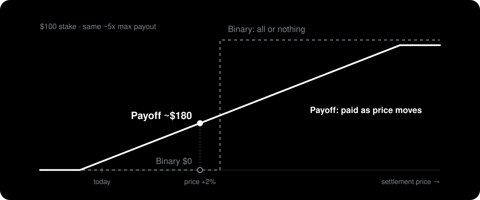

# Payoff — A Prediction Market Built for Prices, Not Events (Hackathon One-Pager)

**Event**: HackQuest BNB Bangkok Hackathon  
**Tracks**: **Developer Track** + **CoinMarketCap × Atlas Challenge**  
**Live App**: [https://bnb.payoff.finance/](https://bnb.payoff.finance/) *(1-click email sign-in · gasless BSC Testnet · automatic `1,000 tUSDT` welcome airdrop)*  
**Network**: BNB Smart Chain Testnet (Chain ID `97`)  
**Repository**: `bnb-payoff` (Full-stack TypeScript + Solidity monorepo, **66/66** automated tests passing, all 4 contracts Sourcify v2 `exact_match` verified)

---

## 1. Problem & Real Product Edge vs. Existing Prediction Markets

Short-term price markets are one of the highest-frequency daily categories on Polymarket and Kalshi—yet forcing continuous asset prices into **`0-or-1` binary contracts** breaks both user experience and liquidity:
- **All-or-Nothing Wipeouts on Right Calls**: With BTC at `$60,276`, buying a `5.0x` binary ticket (`$61,750 or above`) pays **`$0` (`-100%`)** even if BTC surges `+$1,224` (`+2.0%`) to `$61,500`. Meanwhile, perpetual futures liquidate users on sudden overnight wicks.
- **60 Fragmented Rows & Empty Orderbooks (`—`)**: Binary platforms split one expiry into dozens of narrow `or above` rows; over half sit empty (`—`) because extreme expiry pin-risk deters market makers, and bearish traders have to mentally invert `or above → Buy No`.
- **High Churn & Expiry Manipulation Cliff**: Binary lotteries wipe out retail bankrolls ~80% of the time on high-multiplier tiers, and a tiny spot push at expiry flips `100%` of the pool.

**Payoff is a prediction market built for prices, not events.** An event is yes or no. A price is continuous, so the payout should be too. Payoff runs 24/7 continuous-payout markets for **Tokenized US Equities (`NVDA` RWA default)** and **Crypto (`BTC` / `ETH`)**, settled in `tUSDT` on BNB Chain—collapsing 60 fragmented binary rows into **one ticket that pays by how far the price moves**.

- **Right on direction means you get paid**: Take the same `$100` stake and the same `~5x` cap, with BTC at `$60,276`. If BTC rises 2% to `$61,500`, the binary ticket pays **`$0`**. Payoff pays about **`$180`**. Payoff turns a profit from about `+1%`, and still returns about a third of the stake if the price ends flat. On these numbers, a trade ends in profit roughly twice as often.
- **Three choices, one ticket**: Pick a market (`NVDA`, `BTC`, or `ETH`), pick **Up** or **Down**, and drag one slider to set your multiplier. Before you buy, the chart shows what you would be paid at any price.
- **Ten seconds to your first trade**: Sign in with email. There is no wallet to set up and no gas to pay, and `1,000` test USDT arrive automatically. You can sell any part of a position early, or hold it until it settles. The app is available in English and Chinese.
- **Good for the business too**: Traders who are not wiped out on every near miss stay longer, and the protocol earns a fee on every new position from day one.

---

## 2. Deep Atlas Oracle Integration (CoinMarketCap × Atlas Challenge)

Payoff uses **Atlas Enterprise Pull Oracle** and **`ConsensusScore`** as load-bearing security primitives across crypto and 24/7 RWA equities—not cosmetic price displays:

| Atlas Capability | Endpoint / Feed | Load-Bearing Role in Payoff |
|---|---|---|
| **Crypto & RWA Price Feeds** | **`#1005`** (`0x000003ed`, `NVDAB/USD` RWA) **`#626`** (`0x00000272`, `BTC/USD`) **`#632`** (`0x00000278`, `ETH/USD`) | Single unified source of truth for live UI spot, shelf & custom range pricing, chart close anchoring, and on-chain expiry settlement (`21:00 UTC` US Close for NVDA; `08:00 UTC` for BTC/ETH). |
| **Signed Historical Proofs (30m TWAP)** | `POST /v1/price/history` (`signed: true`, 30× 1-min points) | Powers **permissionless 30-minute TWAP settlement** in `AtlasPullSettlementOracle.settleWithAtlasTwap(assetId, expiry, proofs[30])` (`20:31–21:00 UTC` NVDA; `07:31–08:00 UTC` BTC/ETH). Enforces `0s` exact timestamp match within 15m after expiry (`±10s` fallback thereafter), eliminating cherry-picking in one atomic tx (`~344k gas`), with 30m pre-expiry early-close lock. |
| **Signed Live Pull Proofs & RWA Feed Detail** | `POST /v1/price/latest` (`signed: true`) `GET /oracle/user/v1/oracle-feed/feed-detail` | Verified on-chain via `verifyLatestAtlasPrice(assetId)` (`maxLiveFreshness = 180s`), used as HTTP fallback when WS disconnects, and monitors `NVDAB` `shareMultiplier` drift (`>1.0%` triggers automatic stock-split circuit breaker & expiry freeze). |
| **Real-Time WebSocket Stream** | `wss://push.atlasoracle.io/ws` (`modix@auth.price@626`, `632`, `1005`) | Streams sub-second spot ticks + live `consensusScores` with zombie-socket ping watchdog to `@payoff/server`, broadcast to `@payoff/web` over `/ws/stream`. |
| **Enterprise `ConsensusScore`** | `consensusScore`, `consensusStatus`, `twapPrice`, `medianPrice`, `priceVolatility` | Drives **three active safeguards**: 1. **30m TWAP Health Sentinel**: aggregates 1-minute bucketed scores over each asset's final 30m window; if `>= 20/30m` coverage averages `< 40%` (or becomes mathematically irrecoverable), `pauser` freezes the disputed expiry on-chain during the 60s buffer for transparent `owner` `emergencyManualSettle`. 2. **Market Maker Risk Engine** (`@payoff/mock-maker` + `rfqGateway`): widens spreads (`1.35x` `DEGRADED`, `1.85x–2.0x` `WARNING`), scales BS IV floor when `priceVolatility > 0.5%`, halts `OpenQuote` on `CRITICAL`/`SPLIT_MARKET` or RWA split/blackout, and fails closed (HTTP 503) if Atlas goes offline/stale (`>60s`). 3. **Interactive UI Attribution (`Powered by Atlas` Pill → Live Shield Drawer)**: official Atlas badge beside the live spot price opens the real-time Oracle inspector (Feed ID, ConsensusScore, TWAP/Median, separated Oracle Contract vs. Signer BscScan links, `atlasoracle.io`, and self-service 30m TWAP settlement). |

> **API Key & Secret Compliance**: `ATLAS_API_KEY` and `PRIVY_APP_SECRET` are read strictly server-side from gitignored `.env`, never exposed via `/api/health` or `/api/oracle/consensus`, never bundled into `packages/web`, and never committed to Git.

---

## 3. BNB Chain Testnet Contracts & Verified On-Chain Proof

All 4 contracts are live on **BNB Smart Chain Testnet (Chain ID `97`, Block `144840259`)** and verified with **Sourcify API v2 `exact_match`**:

| Contract | BSC Testnet Address | Sourcify v2 |
|---|---|---|
| `MockUSDT` (`tUSDT`, 6-dec) | [`0x20845985df410F84c2e30Ba44A19dD564baE9bED`](https://testnet.bscscan.com/address/0x20845985df410F84c2e30Ba44A19dD564baE9bED) | [`exact_match`](https://repo.sourcify.dev/97/0x20845985df410F84c2e30Ba44A19dD564baE9bED) |
| `AtlasPullSettlementOracle` | [`0x00ea779192dAd354D25016841e3Ff2Bc8f545114`](https://testnet.bscscan.com/address/0x00ea779192dAd354D25016841e3Ff2Bc8f545114) | [`exact_match`](https://repo.sourcify.dev/97/0x00ea779192dAd354D25016841e3Ff2Bc8f545114) |
| `PayoffSpreadVault` | [`0x5a6AaD747cd5313E31fa663fF719b2a18fF00174`](https://testnet.bscscan.com/address/0x5a6AaD747cd5313E31fa663fF719b2a18fF00174) | [`exact_match`](https://repo.sourcify.dev/97/0x5a6AaD747cd5313E31fa663fF719b2a18fF00174) |
| `PayoffVaultLens` | [`0x831532F56ac6aB2B628a7b6cEAb1Eef3a828d60E`](https://testnet.bscscan.com/address/0x831532F56ac6aB2B628a7b6cEAb1Eef3a828d60E) | [`exact_match`](https://repo.sourcify.dev/97/0x831532F56ac6aB2B628a7b6cEAb1Eef3a828d60E) |

**Live On-Chain 30-Point Atlas TWAP Proof Executed on BSC Testnet**:
- **Authorized Production Signer**: `0x59eD4701224fD9e2a85Ef2946c2ab828C1dDC600` (magic marker `0x7096`)
- **Live `verifyLatestAtlasPrice` (`eth_call`)**: `BTC/USD` `$59,653.75598044` (`93.27% HEALTHY`) & `ETH/USD` `$1,679.40804865` (`93.49% HEALTHY`)
- **Live `settleWithAtlasTwap(ASSET_BTC, 1795593600, proofs[30])` Tx**: [`0xe4b6067ea5ba92d688746adf0ac547406fada9f28a81e0250137b5265de2dc90`](https://testnet.bscscan.com/tx/0xe4b6067ea5ba92d688746adf0ac547406fada9f28a81e0250137b5265de2dc90) (Block `144840391`, `344,021` gas)
- **Verified On-Chain Settlement**: `settled = true`, `price = $58,750.15513875`, `samples = 30` (`maxTimestampDiff = 0s`), `window = [1795591860..1795593600]`, `isManualOverride = false`

---

## 4. Technical Safety & Modular Architecture

- **100% Solvency Invariant**: Every minted `UP`/`DOWN` pair locks full `maxPayout` in `tUSDT` (`vaultHealth()` continuously proves `usdtBalance >= lockedUsdt + makerMarginUsdt + protocolFeesUsdt`), eliminating bad debt and liquidation cascades.
- **Cryptographic Settlement Security**: `AtlasPullSettlementOracle` inherits `PullOracleConsumerBase` (`oracle-atlas/pull-oracle-consumer`), enforces EIP-2 low-S ECDSA verification against `authorizedSigner`, rejects zero/future-drifted timestamps, blocks duplicate settlements, and supports per-asset settlement UTC offsets (`08:00 UTC` crypto + `21:00 UTC` US equity close).
- **Battle-Tested Vault Controls**: `Ownable2Step`, `ReentrancyGuard`, `Pausable` (with `merge`, `redeem`, `batchRedeem`, and `withdrawMakerMargin` pause-exempt), EIP-712 + EIP-1271 maker signatures, delegated hot signers, 256-bit bitmap nonces, maker epoch kill switch, self-trade guard, and finite maker approvals (no `MaxUint256`).
- **Transparent Open-Source Reference Market Maker (`packages/mock-maker`)**: Cleanly decoupled from the core protocol via standard EIP-712 `OpenQuote`/`CloseQuote` structs. Judges can inspect the exact Black-Scholes valuation, Put-Call Parity no-arbitrage proofs (`UP_ask + DOWN_ask > width`, `UP_bid + DOWN_bid < width`), NVDA OCC strike & 24/7 RWA session/ThetaData IV pricing, Quick/Custom guardrail bounds, and atomic-merge `+25 bps` early-exit improvement—proving live testnet quotes come from real financial math while enabling any third-party MM to drop in and compete.
- **Gasless Retail UX + Full Self-Custody Exit**: Privy email sign-in creates an embedded EVM wallet on BSC Testnet with sponsored gas, instant `1,000 tUSDT` welcome airdrop, standalone `Mint` faucet modal, Deposit/Withdraw transfers, and user-controlled wallet key export.

---

## 5. Roadmap

1. **BNB Smart Chain Mainnet Launch**: External security audit of `PayoffSpreadVault` & `AtlasPullSettlementOracle`, native USDT collateral integration, Gnosis Safe multisig + timelock governance, and full BscScan + Sourcify verification.
2. **Multi-MM Competitive RFQ Network**: Onboard independent professional market makers competing on the same EIP-712 `OpenQuote` / `CloseQuote` standard, maximizing user multipliers and early-exit liquidity via atomic merge competition.
3. **Scaling Beyond Live `NVDA` RWA (`#1005`), `BTC` (`#626`) & `ETH` (`#632`)**: Replicate our production RWA + Atlas `ConsensusScore` pipeline to **BNB/USD**, high-demand US equities (**TSLA, AAPL, COIN, MSTR**), and macro commodities (**Gold / Silver**) backed by Atlas Pull Oracle custom feeds.
